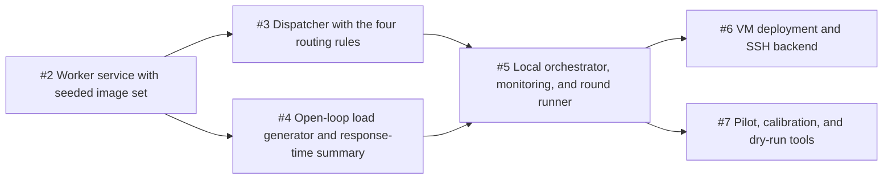

# Orchestration plan: pre-run build

How a Claude orchestrator agent builds `implementation/spec.md` one issue at a time. The PRD is issue #1, the tracking issue is #8, and the implementation issues are #2 to #7 in `ihmorol/performance-aware-load-balancing`. Every issue's body holds its scope, definition of done, and verification steps. This file only sets the order and the rules.

## Issues

| Issue | Title | Wave | Blocked by | Parallel within its wave |
|---|---|---|---|---|
| #2 | Worker service with seeded image set | 1 | None | No (only issue in wave 1) |
| #3 | Dispatcher with the four routing rules | 2 | #2 | Yes, with #4 |
| #4 | Open-loop load generator and response-time summary | 2 | #2 | Yes, with #3 |
| #5 | Local orchestrator, monitoring, and round runner | 3 | #3, #4 | No (only issue in wave 3) |
| #6 | VM deployment and SSH backend | 4 | #5 | Yes, with #7 |
| #7 | Pilot, calibration, and dry-run tools | 4 | #5 | Yes, with #6 |

## Why the waves look like this

- #2 comes first and alone because it sets the project layout, the whole config schema, and the header names that every other issue reads.
- #3 and #4 run in parallel. #3 works in `implementation/dispatcher/`, #4 in `implementation/experiments/` and the summary module in `plb`. Neither changes the config schema, because #2 defines all of it. The dispatcher-side summary fields wait for #5 so #4 doesn't depend on #3's log format.
- #5 runs alone because it joins the outputs of #3 and #4 and defines the backend interface.
- #6 and #7 run in parallel. #6 adds a backend class and files in `implementation/setup/`; #7 adds the pilot commands and only calls the backend interface. They may both touch the backend or command registry line, which is a small conflict to fix at merge.

## Instructions for the orchestrator agent

1. Read `AGENTS.md`, `implementation/spec.md`, and this file. Read every issue in the current wave with `gh issue view <n>`.
2. Before the first commit, confirm with the repository owner that starting this plan authorizes branches, commits, pushes, pull requests, and merges for issues #2 to #7. AGENTS.md requires that authorization.
3. The docs PR that adds `implementation/spec.md` and this file must be merged into `main` before wave 1 starts. Every branch starts from the latest `main`.
4. Run one wave at a time, in order: wave 1 (#2), wave 2 (#3 and #4), wave 3 (#5), wave 4 (#6 and #7). Issues inside one wave may be built at the same time by separate implementer agents, each in its own worktree.
5. For each issue:
   - Create a branch named `feat/<issue number>-<short-kebab-title>`, at most 60 characters, from the latest `main`.
   - Build it test-first with the `tdd` skill, staying inside the issue's scope. Work that belongs to another issue stays out, even when it looks easy.
   - Run every verification step in the issue body and check every definition-of-done box. Paste the commands and their output in the PR description.
   - Open a PR whose body says `Closes #<issue number>` and links the PRD (#1).
   - Merge the PR only when the definition of done and the verification steps pass, then check that the issue closed and tick it on the tracking issue (#8).
6. Start the next wave only after every issue in the current wave is merged into `main`. Before starting it, pull `main` and run `python -m pytest` from `implementation/`; it must pass.
7. If verification fails, fix it on the same branch inside the same issue. Never skip ahead to a later issue or wave, and never close an issue with a failing check. If a fix needs a change outside the issue's scope, or a check can't pass in the agent's environment, stop and ask the owner. Don't work around it.
8. All prose (README sections, PR descriptions, comments) follows the AGENTS.md writing rules. Never describe a planned experiment as done.
9. After wave 4, stop and hand over to the owner. The steps below need a person at the experiment PC.

## Manual steps after wave 4 (not issues)

These need the teammate's PC with VirtualBox. An agent can't do them.

- [ ] Hardware check for #6: build the three VMs from `implementation/setup/README.md`, run one `orchestrate run --backend ssh` per scenario, and confirm the scenario 3 run shows a rising nr_throttled.
- [ ] Run the pilot steps from #7 in the order of the spec's "Pilot and calibration" table and record each value with its method in `notes/decisions.md`.
- [ ] Fill the config, set its stage to `main`, commit it, and record the commit id.
- [ ] Run `experiments.pilot dry-run --backend ssh` and fix anything until it prints PASS.
- [ ] Main runs can start (weeks 4 to 5).

## Progress

- [ ] #2 Worker service with seeded image set (wave 1)
- [ ] #3 Dispatcher with the four routing rules (wave 2)
- [ ] #4 Open-loop load generator and response-time summary (wave 2)
- [ ] #5 Local orchestrator, monitoring, and round runner (wave 3)
- [ ] #6 VM deployment and SSH backend (wave 4)
- [ ] #7 Pilot, calibration, and dry-run tools (wave 4)

Progress is tracked on issue #8. This list is a copy at the time of writing.
